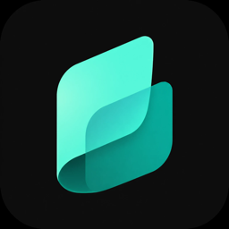

# Stagebook

[English](README.md) · **Português (Brasil)**

Letra, cifra e backing track num app só, para tocar ao vivo no Android. Sozinho ou com a banda.

**Ajuda, com imagens de cada tela:** [docs/ajuda](docs/ajuda/index.html)

## O que ele faz
- **Palco:** tela cheia, acesa, em páginas ou rolando. Vira com pedal Bluetooth ou MIDI (USB e Bluetooth), com toque
  ou com a rolagem automática. Cada botão do pedal pode fazer outra coisa.
- **Cifras:** acordes em cima da letra (ChordPro), transpor, capotraste, tablatura e o diagrama de cada acorde no
  violão, guitarra, ukulele, cavaquinho ou teclado, com som. Mostra também o campo harmônico do tom.
- **Setlists:** monte o show e arraste para mudar a ordem. Mande para quem está do lado por QR, para longe com 3
  palavras pela internet, ou para a banda toda no mesmo Wi-Fi.
- **Banda:** com o "Quem conduz", quem puxa o setlist troca de música e o palco de todo mundo acompanha. Antes de
  começar, o app avisa quem não tem alguma música.
- **Backing track:** OGG com quantos canais tiver, MP3 ou WAV, numa interface de áudio USB ou na saída do aparelho. Tem
  mixer, roteamento por saída, EQ e normalização.
- **Metrônomo**, importação de letras e cifras pelos sites, **Now Playing** para OBS e Resolume
  ([formato](docs/now-playing.pt-BR.md)), backup num arquivo `.stagebook` e um **modo essencial** que desliga o que você não
  vai usar.
- Sem conta, sem propaganda, sem rastreio. Suas músicas ficam no aparelho. O que vai para a banda ou pelas 3 palavras
  vai cifrado.

## Player pela USB
- Interface de áudio USB **class compliant** (USB Audio Class 2.0, funciona no computador sem driver).
- Que aceite **48 kHz**.
- Celular ou tablet com **USB OTG** e o cabo ou adaptador certo.

Interfaces só USB Audio 1.0, ou só de 44,1 kHz, ainda não funcionam. Sem interface, o player toca no fone, no
Bluetooth ou no alto-falante do aparelho.

## Quanto o app pesa
Medido em aparelhos de verdade, um minuto por tela (processador em % de **um** núcleo; os três têm 8 núcleos):

| Tela | TCL NXTPAPER 11 Plus | Galaxy S26 Ultra | Chuwi Hi10 XPro |
|---|---|---|---|
| Lista de músicas, parada | 1,4% · 194 MB | 0,1% · 136 MB | 1,5% · 117 MB |
| Palco, parado | 1,4% · 219 MB | 0,3% · 167 MB | 0,4% · 121 MB |
| Palco, virando página a cada 3 s | 12,7% · 198 MB | 3,8% · 146 MB | 2,9% · 120 MB |
| Palco, acompanhando a banda | — | 0,2% · 253 MB | 8,8% · 114 MB |
| Conduzindo a banda por 5 minutos (9 músicas, uma página a cada 2 s) | 5,0% · 194 MB | 0,8% · 186 MB (acompanhando) | 2,4% · 124 MB (acompanhando) |
| Mandando um setlist para a banda | 2,6% · 198 MB | 0,0% · 160 MB (recebendo) | — |
| Backing track tocando numa interface USB | 15% · 202 MB | — | — |
| Ajustes da banda, parado | 3,1% · 205 MB | 7,2% · 186 MB | 0,6% · 123 MB |

Mesmo tocando uma faixa, o Stagebook usa menos de 2% do processador inteiro. O modo essencial quase não muda esses
números: o ganho dele é a tela mais simples.

## Usar com assistentes de IA (MCP)
O Stagebook tem um [servidor MCP](mcp/README.pt-BR.md) que deixa o Claude Code, o Claude Desktop, o Cursor, o VS Code, o
Gemini CLI, o Codex e outros assistentes de IA lerem e editarem a sua biblioteca: "monta um setlist de 15 músicas para
sábado", "passa as músicas deste artista meio tom abaixo", "confere os acordes desta música", "importa esta página". Ele
roda no seu computador e conversa com o tablet pelo Wi-Fi, por **Ajustes → Editar no computador**; você autoriza o
computador uma vez no tablet. Instalação e configuração de cada assistente: [mcp/README.pt-BR.md](mcp/README.pt-BR.md).

## Instalar
Baixe o `stagebook.apk` nos [Releases](../../releases). Depois disso o app avisa quando sai versão nova e se atualiza.
Precisa de Android 9 ou mais novo.

## Apoie
O Stagebook é gratuito e sem propaganda. Se ele ajuda nos seus ensaios e shows, que tal me pagar um café no
[Buy Me a Coffee](https://buymeacoffee.com/julianoaffonso)? Qualquer valor ajuda a manter o app.

## Traduzir
O app sai em inglês e português do Brasil. Fala outro idioma e toca? O passo a passo está em
[docs/TRANSLATING.pt-BR.md](docs/TRANSLATING.pt-BR.md). Não precisa saber programar.

## Para quem programa
Kotlin, Jetpack Compose e um motor de áudio em C. `./gradlew assembleDebug` compila e
`./gradlew testDebugUnitTest` roda os testes (Java 21). As versões são publicadas pelo GitHub Actions. Todo mundo aqui segue o
[Código de Conduta](CODE_OF_CONDUCT.pt-BR.md).

## Licença
Código disponível sob a **PolyForm Shield 1.0.0** ([LICENSE.md](LICENSE.md)). Pode usar à vontade, até em show pago,
mudar e redistribuir. Só não vale usar o código para fazer um app concorrente.

`Required Notice: Copyright Stagebook (https://stagebook.app.br)`

Decodificadores de áudio de terceiros, em `app/src/main/cpp/third_party`, cada um com a licença no próprio arquivo:
stb_vorbis (domínio público ou MIT), dr_mp3 e dr_wav (domínio público ou MIT-0).
